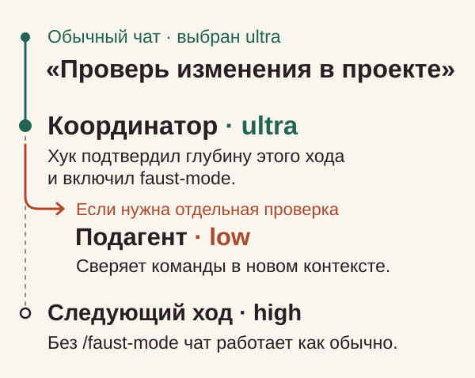

# fstack

**43 инженерных навыка для Codex.** Попроси проверить автотесты, найти причину
сбоя или довести исправление до ревью. Для одной задачи можно вызвать отдельный
навык. Для работы в несколько этапов есть координатор.

[Быстрый старт](#быстрый-старт) · [Аудит на практике](#аудит-на-практике) · [Выбор глубины](#кто-выбирает-глубину) · [Каталог навыков](docs/skills.md)

<a id="от-запроса-к-результату"></a>

## Аудит на практике

В учебном проекте журнал оставлял файл блокировки после закрытия. Локальная
команда давала зелёный результат. Агент сравнил **две выборки тестов**
и нашёл пропущенный сценарий повторного открытия журнала.


Обе команды выполнили на одной машине. Ошибка воспроизводится без стенда.
В [пошаговом примере](docs/examples.md#повторить-аудит-блокировки) можно включить
дефект, увидеть `FileExistsError` и повторить проверку с рабочей очисткой.

## Быстрый старт

```bash
codex plugin marketplace add WhyFaust/fstack --ref main
codex plugin add fstack@fstack
```

Одобри хуки и открой чат в каталоге проекта. Для первого разбора подойдёт такой запрос.

```text
$fstack:audit Изучи проект автотестов.
Что улучшить сейчас, а что отложить?
Как проверить каждое предложение?
Пока только разбор.
```

Агент покажет, какие файлы и сценарии изучил, и предложит решение по каждому
пункту. Можно выбрать пункты по ID или принять его порядок. Если выбор зависит
от того, готов ли ты менять общий ресурс или запускать стенд, агент уточнит это
на конкретной находке. [Примеры запросов](docs/examples.md)

<a id="что-находится-где"></a>

## Кто выбирает глубину

В обычном чате с одобренными хуками `ultra` включает координатор **на текущее
сообщение**. Если есть самостоятельное поручение, координатор выбирает глубину
по его сложности. В проверке ниже исполнитель получил свежий контекст и `low`.



| Что нужно | Как включить |
| --- | --- |
| Один конкретный навык | Начни запрос с `$fstack:audit`, `$fstack:debug` или другого имени из каталога. |
| Координатор на весь чат | Введи `/faust-mode`. Команда работает и во временном чате без журнала. |
| Выключить режим и автовключение на `ultra` | Введи `/faust-mode-off`. В этом чате режим можно снова включить вручную. |

Глубину исполнителя сверили по его журналу и запросу к локальной заглушке в
CLI и бинарнике Desktop. [Настройки и диагностика](docs/installation.md#настройки-подагентов)

[Как выбрать навык](skills/README.md#как-выбрать-метод) · [Разработка и проверки](docs/development.md) · [Бенчмарки](docs/benchmarks.md) · [Оценка навыков](docs/evaluations.md) · [Лицензия fstack](LICENSE)
