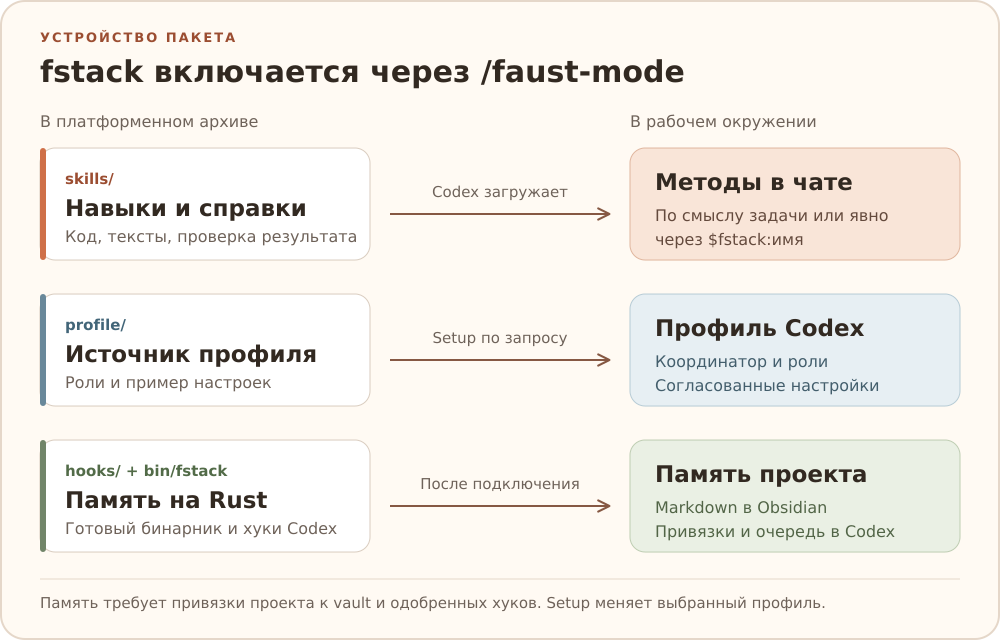
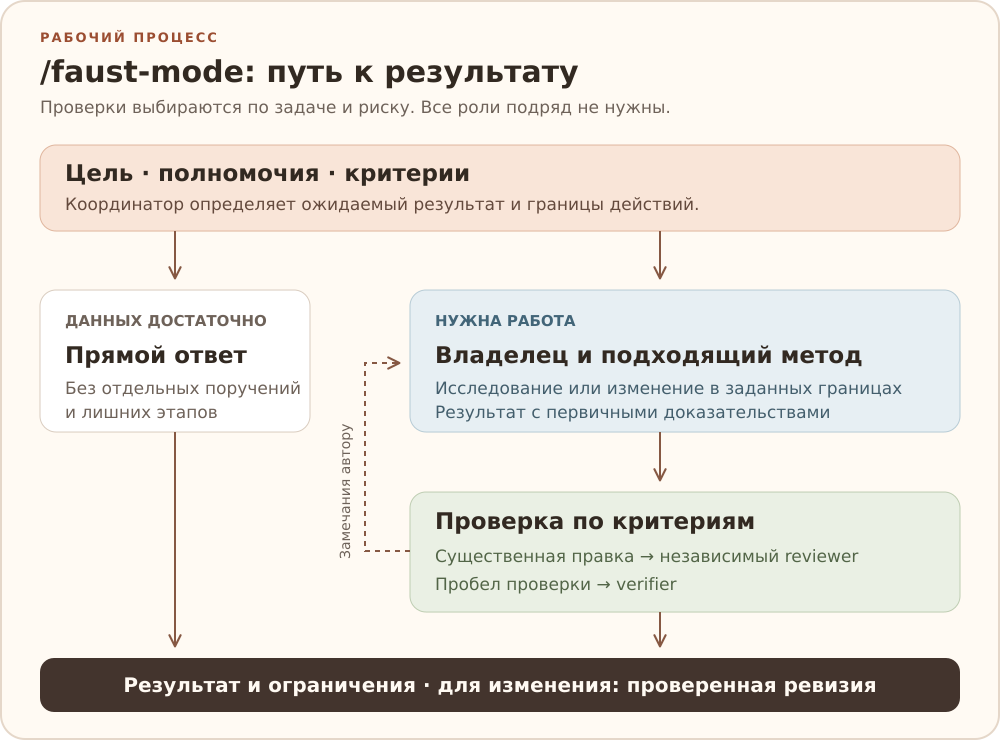

<div align="center">


# fstack

**Faust stack · навыки и память проектов для Codex**

Понять задачу. Сделать нужное. Проверить результат.

[Установка](#установка) · [Навыки](docs/skills.md) · [Оркестрация](docs/orchestration.md) · [Память](docs/memory.md) · [Разработка](docs/development.md)


</div>

fstack добавляет в Codex методы для работы с кодом и текстом и протокол
делегирования агентам Codex. Для подключённых проектов есть долговечная
память в Obsidian. Фоновый хук подготавливает нативный бинарник для системы.



## Какие задачи решает

| Задача | Основные навыки |
| --- | --- |
| Разобраться в коде и выбрать улучшения | `investigate-code`, `improve-codebase` |
| Добавить возможность, исправить сбой или упростить код | `implement-change`, `debug-failure`, `refactor-code` |
| Спроектировать изменение или интерфейс | `design-change`, `design-ui` |
| Проверить свойство автомата и показать трассу | `model-check-state` |
| Проверить diff, доказательства или пользовательский сценарий | `review-change`, `verify-result`, `verify-project` |
| Подготовить повторяемую проверку пользовательских путей | `prepare-verification`, `maintain-verification` |
| Написать, отредактировать текст или проверить факты | `write-text`, `edit-text`, `research-for-text` |
| Разобрать присланную статью, PDF или книгу и выполнить поручение по материалу | `deepread` |
| Создать или улучшить навык | `adapt-skill` |
| Продолжить задачу или разобраться с PR/MR | `checkpoint-task`, `resume-task`, `watch-pr`, `resolve-review` |

Предметные методы дополняют основной: например, `python` помогает с Python-кодом
и автотестами, `assess-impact` с последствиями изменения общего контракта,
`no-comments` с выражением намерения через имена и структуру кода. Необходимые
лицензии, директивы и контрактная документация сохраняются.
[Каталог навыков](docs/skills.md) описывает границы и способы выбора.

По умолчанию координатор выключен. Для полного процесса начни запрос с
`/faust-mode`, для отдельного метода вызови его явно:

```text
/faust-mode Посмотри, что стоит улучшить в этом проекте, и расставь приоритеты.
Используй $fstack:debug-failure: установи причину сбоя этого запуска и исправь её.
Используй $fstack:review-change: проверь этот diff по требованиям задачи.
Используй $fstack:edit-text: упрости объяснение, сохрани факты и ограничения.
```

Одного вызова достаточно на весь чат. Для выключения начни сообщение с
`/faust-mode-off`. В новом чате режим снова выключен. Миграция
и границы изоляции описаны в [руководстве режима](docs/faust-mode.md).

## Как устроена работа в faust-mode



Для простого вопроса достаточно прямого ответа. Если задача требует поручения,
координатор сравнивает доступные роли по задаче и правам. Для отчёта Allure
он может выбрать агента проекта, который умеет разбирать попытки и вложения.
Среди встроенных ролей для исследования кода подходит `explorer`, для изменения — `worker`,
для независимой проверки — свежий агент общего назначения.
Поручение включает нужный навык и критерии результата.

Если независимый прогон CI проверил критерий на текущей ревизии, его достаточно
для приёмки. Ревью кода проводят по требованию пользователя или проекта либо
когда в реализации остался конкретный вопрос.
Каждый исполнитель возвращает источники, ограничения и сведения для памяти
проекта. Последнее решение о записи принимает координатор.

[Примеры выбора исполнителя и приёмки](docs/orchestration.md#от-поручения-к-приёмке) ·
[Выбор и запуск агента](docs/codex.md#делегирование) ·
[От Draft MR до слияния в GitLab](docs/orchestration.md#от-draft-mr-до-слияния-в-gitlab)

## Установка

Нужны Git и Codex с поддержкой плагинов и фоновых хуков. На Linux, macOS и Windows:

```bash
codex plugin marketplace add WhyFaust/fstack --ref main
codex plugin add fstack@fstack
```

Одобри хуки fstack и открой чат. При первом запуске плагин скачает
готовую сборку для системы и проверит SHA-256.
[Установка и поддерживаемые платформы](docs/installation.md#через-маркетплейс).

## Память проектов

Одобри хуки fstack в Codex. В обычном чате память сама находит рабочий vault
Obsidian и заводит область проекта при первом запросе. Существующие записи
остаются на месте. Если на устройстве несколько подходящих vault, один раз
выбери рабочий через `memory vault --set PATH`. Markdown хранится в `Codex Memory`,
локальная привязка и очередь операций — в профиле Codex.

В режиме `auto` агент оценивает результат обычного хода и сохраняет обоснованные
долговечные решения, поправки и предпочтения. Кандидаты, которым нужна проверка,
попадают в Inbox. Если подходящих новых знаний нет, оценка заканчивается
без заметки. Замечание о текущем проекте остаётся в нём. Явное предпочтение
«во всех проектах» доступно и в других проектах того же vault. Режим `inbox` оставляет все новые записи для ручной проверки.

Хуки подбирают записи подключённого проекта и применяют подготовленную агентом
операцию. Они не читают историю чатов и не решают сами, что стоит запомнить.
В Obsidian доступны страницы проектов, таблица Bases и карта Canvas.
Подключение, доверие к хукам и работа на нескольких устройствах описаны
в [руководстве памяти](docs/memory.md).

## Обновление

Codex с поддержкой автообновления Git marketplace получает пакет из `main`
при запуске. Новый чат подготавливает подходящий бинарник. При переходе со старого пакета
хук удаляет только [неизменённые роли fstack](docs/codex.md#миграция-прежних-ролей).
Для старых регистраций `marketplace/<target>` один раз
[переключи ветку на main](docs/installation.md#переход-с-платформенной-ветки).

## Разработка и лицензии

Runtime и проверки находятся в `tools/fstack/`. Для разработки нужны Rust 1.90.0
и системный C/C++ toolchain для сборки встроенного SQLite. CI выполняет сборку,
fmt, clippy, тесты и проверки пакета на Linux x64, Windows x64 и macOS
Intel/Apple Silicon. Проверка установки в фактическом Codex запускается отдельно
и не подтверждает исполнение поручений моделью.

[Команды проверок и правила релиза](docs/development.md) ·
[Карта пользовательских сценариев fstack](docs/development.md#карта-пользовательских-сценариев) ·
[Настройки Codex](docs/codex.md) ·
[Внешние интеграции](docs/integrations.md)

Исходный код fstack распространяется по [MIT](LICENSE).
Лицензии и обязательные уведомления включённых материалов и зависимостей
сохранены в [licenses/](licenses/).
