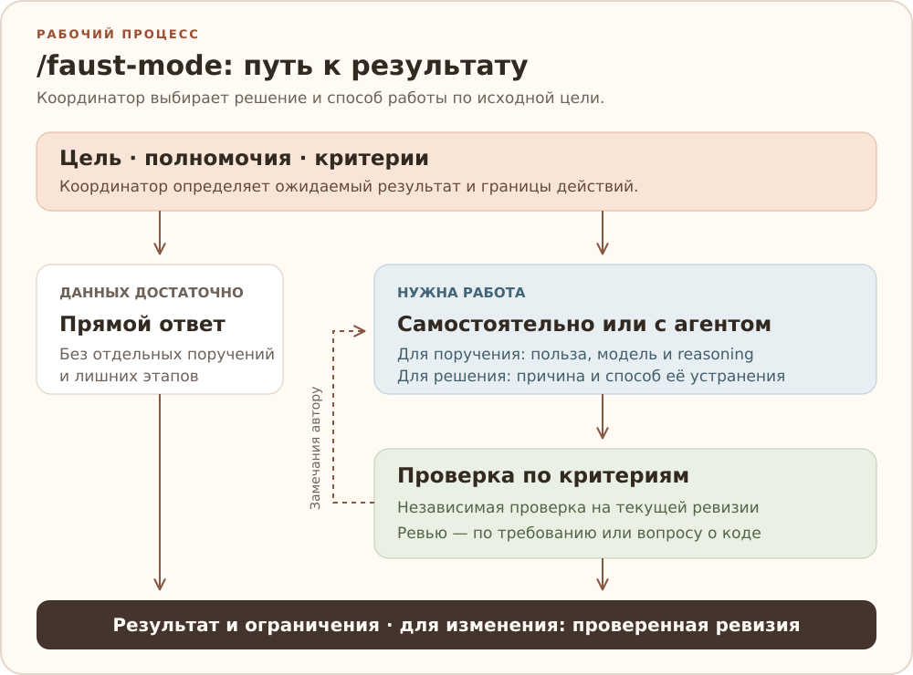

<div align="center">


# fstack

**44 инженерных навыка и память проектов для Codex**

[Быстрый старт](#быстрый-старт) · [Каталог](docs/skills.md) · [Как выбрать навык](skills/README.md#как-выбрать-метод) · [Примеры](docs/examples.md)


</div>

## Быстрый старт

```bash
codex plugin marketplace add WhyFaust/fstack --ref stable
codex plugin add fstack@fstack
```

Одобри хуки и открой чат. Для разбора сбоя можно начать так:

```text
/faust-mode Разберись, почему публикация отчёта зависает. Вот лог и ссылка на джобу.
```

По умолчанию координатор выключен. `/faust-mode` включает его в текущем чате,
`/faust-mode-off` выключает. Без режима прямой вызов, например `$fstack:why`,
разрешает только выбранный навык. [Установка и диагностика](docs/installation.md).

## От запроса к результату



Координатор сверяет задачу с [каталогом](docs/skills.md). При переходе от
диагностики к правке, прогону и ревью он читает инструкции для нового этапа.
Независимые поручения можно передать подагентам. Модель и разрешения задаёт
клиент. [Примеры задач](docs/examples.md) · [План и цель в Codex](skills/plan/SKILL.md#plan-и-goal-в-codex).

## Что находится где


Память Obsidian подключается отдельно и работает в обоих режимах.
В режиме `auto` подтверждённые решения сохраняются при завершении хода, в `inbox`
все новые записи проходят ручную проверку. [Подключение памяти](docs/memory.md).

[Разработка и выпуск](docs/development.md) · [Бенчмарки runtime](docs/benchmarks.md) ·
[Оценка качества навыков](docs/evaluations.md) · [Лицензия MIT](LICENSE) ·
[Лицензии включённых материалов](licenses/)
