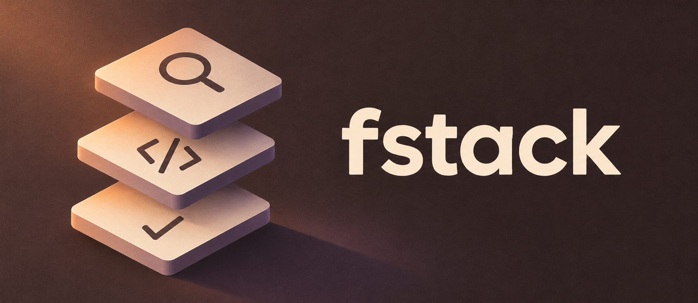

<div align="center">


# fstack

**Faust stack · личная инженерная среда для Codex**

Понять задачу. Сделать нужное. Проверить результат.

[Начать](docs/installation.md) · [Codex и агенты](docs/codex.md) · [Навыки](docs/skills.md) · [Архитектура](docs/architecture.md) · [Разработка](docs/development.md)



</div>

## Небольшие методы для законченной работы

34 навыка и пять ролей. Основные методы отвечают за исследование, реализацию,
диагностику, рефакторинг и ревью. Отдельные небольшие навыки нужны для
планирования, проектирования, оценки последствий, упрощения, продолжения задачи
и PR/MR. Для кода действует отдельный no-comments.
Подключай только применимое; обязательной цепочки из всех навыков нет.

| Направление | Результат |
| --- | --- |
| Код и инженерные решения | Полное изменение с ясными контрактами и владельцами |
| Python | Окружение, типизация, ошибки, I/O и ресурсы; автотесты — по задаче |
| Стиль кода | Намерение в именах и структуре; необходимые лицензии и директивы сохраняются |
| Проверка проекта | Воспроизводимый пользовательский путь и сохранённые артефакты |
| Продолжение работы | Контрольная запись и сверка состояния после смены контекста |
| PR/MR | Актуальные CI и обсуждения, отдельно разрешённое слияние |
| Память и шум | Отдельные VaultGoblin и RTK по их фактическим возможностям |

[Полный каталог](docs/skills.md) показывает границы каждого метода.
Роли auditor, coder, python_coder, reviewer и allure_analyst используют
выбранные методы. Свежий контекст независимого ревью задаёт координатор;
ключевое правило входит в автоматически синхронизируемый блок профиля.

## Установка

Репозиторий публичный. Нужны Git и Codex с поддержкой repo marketplace.

```bash
codex plugin marketplace add WhyFaust/fstack --ref main
codex plugin add fstack@fstack
```

Открой новую сессию для обнаружения установленной версии и вызови
`$fstack:fstack-setup`: просмотр плана, затем разрешённая синхронизация пяти ролей
и управляемого блока AGENTS.md. Пример config.toml объединяется отдельно.

```text
Используй $fstack:debug-failure: установи причину сбоя этого запуска и исправь её.
Используй $fstack:resume-task: продолжи задачу по указанной контрольной записи.
Используй $fstack:watch-pr: проверь состояние этого PR и его текущий SHA.
```

## Отдельные компоненты

[VaultGoblin](https://github.com/WhyFaust/VaultGoblin) — отдельный плагин Faust
для общих знаний Codex между устройствами через синхронизируемый Obsidian vault.
Он используется для релевантной истории, которая сверяется с текущими источниками.

[RTK](https://github.com/rtk-ai/rtk) отдельно сокращает шумный вывод поддерживаемых
команд. Для решающего вывода сохраняются полные логи и первичные артефакты.
fstack не устанавливает эти компоненты и не переносит их настройки или данные.
[Правила интеграции](docs/integrations.md).

## Обновление

```bash
codex plugin marketplace upgrade fstack
codex plugin add fstack@fstack
```

Повтори `$fstack:fstack-setup` для ролей новой версии и открой новую сессию.
При переходе с `python-aqa` используй `$fstack:python`; старое имя удалено.
Порядок обновления ссылок описан в [инструкции перехода](docs/installation.md#переход-на-python).
Меняй исходники в репозитории: установленный кэш заменяется при обновлении.
Версия плагина следует SemVer и Conventional Commits. Версия навыка обновляется
только при изменении его инструкции, UI, справок или ресурсов и обозначает
последний изменивший его релиз. ZIP и SHA-256 находятся
в [релизах](https://github.com/WhyFaust/fstack/releases).

[Установка и восстановление](docs/installation.md), [профиль Codex](docs/codex.md),
[разработка и проверки](docs/development.md), [лицензия](LICENSE).
