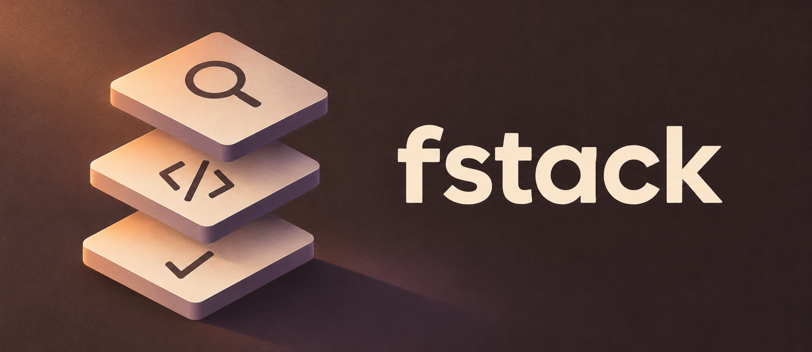

<div align="center">


# fstack

**Инженерные навыки, оркестрация и память проектов для Codex**

Понять причину. Выбрать решение. Довести до проверенного результата.

[Начать](#быстрый-старт) · [Как работает](#от-запроса-к-результату) · [Примеры](docs/examples.md) · [Бенчмарки](docs/benchmarks.md) · [Каталог](docs/skills.md)



</div>

fstack добавляет в Codex методы работы с кодом, исследованиями и текстом.
Координатор выбирает навыки, выполняет связную работу сам и передаёт независимые
поручения агентам. Память в Obsidian сохраняет решения и поправки для следующих
чатов проекта.

| Разобраться | Сделать | Подтвердить |
| --- | --- | --- |
| Найти причину сбоя и владельца механизма | Выбрать простое законченное решение | Проверить поведение на актуальной ревизии |
| Сверить гипотезу с логами и исходниками | Подобрать модель под поручение | Показать доказательства и ограничения |

## Быстрый старт

Нужны Git и Codex с поддержкой плагинов и хуков. На Windows, Linux и macOS:

```bash
codex plugin marketplace add WhyFaust/fstack --ref main
codex plugin add fstack@fstack
```

Одобри хуки fstack и открой чат. Плагин подберёт готовый бинарник для системы
и проверит SHA-256. [Подробная установка и платформы](docs/installation.md).

```text
/faust-mode Разберись, почему публикация отчёта не завершается.
Вот лог и ссылка на джобу. Предложи исправление и способ его проверить.
```

Координатор действует в этом чате до `/faust-mode-off`. По умолчанию он выключен.
Отдельный навык можно вызвать напрямую: `$fstack:review-change`.
Одобренные хуки памяти работают независимо от режима.

## От запроса к результату


Для сбоя сначала устанавливают, какое условие порождает отказ. Перед реализацией
оценивают получившуюся систему: состояния, зависимости и сопровождение.
Размер diff и зелёные тесты выбранной схемы сами по себе не доказывают,
что схема решает исходную задачу.

Отдельный агент полезен для независимого исследования, параллельной работы
или проверки. Единую цепочку решений по одним данным может вести один владелец.
Он же получает замечания и доводит изменение до результата.

| Поручение | Начальный ориентир | Reasoning |
| --- | --- | --- |
| Извлечь известные факты, сверить статус | Luna | low / medium |
| Реализовать понятный контракт | Sol | medium |
| Установить неоднозначную причину, проверить архитектуру | Sol | high |

Выбор зависит от доступных моделей и схемы клиента. Координатор передаёт параметры
явно и отличает запрошенную модель от подтверждённой. fstack не закрепляет модели
за ролями и не задаёт численного лимита агентов.
[Делегирование](skills/delegate-work/SKILL.md) · [Настройки](docs/installation.md#настройки-подагентов).

## Что можно поручить

| Запрос | Метод | Проверяемый результат |
| --- | --- | --- |
| "Почему эта джоба падает?" | `debug-failure` | Причина с доказательствами и проверка исправления |
| "Добавь возможность" | `implement-change` | Законченное изменение с потребителями и проверками |
| "Нужна ли такая архитектура?" | `design-change` | Сравнение вариантов по ограничениям задачи |
| "Посмотри этот diff" | `review-change` | Достижимые дефекты и вопросы к выбору решения |
| "Проверь пользовательский путь" | `verify-project` | Наблюдаемое поведение и воспроизводимые доказательства |
| "Разбери статью и примени полезное" | `deepread` | Выводы по источнику и выполненное поручение |
| "Стали ли новые правила лучше?" | `codex-config-evaluation` | Контролируемое сравнение с пределами вывода |

[Все навыки](docs/skills.md) · [Примеры запросов и самостоятельные прогоны](docs/examples.md).

## Как проверяем сам fstack

| Проверка | Что подтверждает | Доказательства |
| --- | --- | --- |
| Сборка, тесты, структура пакета | Корректность runtime, метаданных и ресурсов | [CI](https://github.com/WhyFaust/fstack/actions/workflows/release.yml) |
| Установка в фактический Codex | Обнаружение навыков и хуков клиентом | [Отдельная проверка установки](docs/development.md#проверка-фактическим-клиентом) |
| Замеры команд с проверкой ответов | Время работы runtime в указанных условиях | [Сырые данные и методика](docs/benchmarks.md) |
| Повтор задач с разными правилами | Изменения поведения агента | [Протокол экспериментов](docs/evaluations.md) |

Замеры runtime запускаются в CI и сохраняются артефактом. Опубликованная таблица
строится из сырых данных; при изменении измеряемых файлов её статус требует
обновления. Прогоны моделей выполняются по отдельному запросу. Неудачные запуски,
ничья и отсутствие достаточных данных входят в отчёт.

## Что находится где


В Obsidian хранятся читаемые заметки проекта. В режиме `auto` агент сохраняет
подтверждённые решения и поправки, а сведения для проверки отправляет в Inbox.
В режиме `inbox` все новые записи проходят ручную проверку. Явно общие предпочтения
доступны другим проектам того же vault.
[Подключение памяти и синхронизация устройств](docs/memory.md).

## Обновление и разработка

Codex с поддержкой автообновления Git marketplace получает пакет из `main`
при запуске. Новый чат подготавливает подходящий бинарник.
[Переход со старых установок и миграция профиля](docs/installation.md#обновление).

Runtime и проверки находятся в `tools/fstack/`. Для разработки нужны Rust 1.90.0
и системный C/C++ toolchain. Бенчмарки используют Python 3.11+ без дополнительных
пакетов. CI собирает Linux x64, Windows x64 и macOS Intel/Apple Silicon.
[Сборка, обязательные проверки и выпуск](docs/development.md).

Код распространяется по [MIT](LICENSE). Лицензии и уведомления включённых
материалов и зависимостей сохранены в [licenses/](licenses/).
