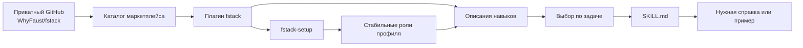

# Архитектура

## От исходников до задачи



Git-репозиторий владеет исходниками. Каталог сообщает Codex, откуда установить
плагин. Манифест задаёт версию, каталог навыков и оформление. Клиент создаёт
установленную копию, а новый чат обнаруживает её навыки.

## Структура

```text
fstack/
├── .agents/plugins/marketplace.json
├── .codex-plugin/plugin.json
├── .github/workflows/release.yml
├── assets/
├── docs/
├── profile/
├── scripts/
└── skills/
    └── <skill-name>/
        ├── SKILL.md
        ├── agents/openai.yaml
        └── references/ или assets/ по необходимости
```

У каждого навыка своё назначение и точка входа. `verify-result` содержит общий
контракт доказательств; основные методы ссылаются на него. `engineering-principles`
добавляет критерии к конкретному решению. Инструментальные навыки дополняют метод,
когда задача требует соответствующей технологии.

## Границы

Плагин содержит инструкции и учебные данные. Он не регистрирует хуки и сервисы,
не переносит MCP-настройки или авторизацию. Роли и короткий блок связей `AGENTS.md`
синхронизируются отдельной явной командой с резервной копией и учётом ручных правок.
Инструменты
GitLab, Context7, Playwright и среда Python предоставляются окружением; навык
объясняет их применение, но не устанавливает их при загрузке.

Встроенные и сторонние плагины обновляются у своих владельцев. В fstack находятся
личные навыки, роли и переносимые шаблоны. История чатов, память и материалы
рабочих проектов не входят в пакет.

## Контроль качества

Структурная проверка связывает манифест, каталог, версии навыков, роли,
относительные ссылки и ресурсы. Автотесты и установочные тестовые сценарии
в репозитории не хранятся. Проверка структуры не подтверждает поведение модели,
интеграций или пользовательских стендов.

Изменение формулировок само по себе не доказывает рост качества или экономию
токенов. Для такого вывода нужен отдельный согласованный сравнительный эксперимент.

Формат и пути сверяются с [официальной документацией плагинов](https://developers.openai.com/plugins/build/plugins)
и [навыков](https://learn.chatgpt.com/docs/build-skills). Используемый совместимый
манифест `.codex-plugin/plugin.json` проверяется установленной версией Codex.
