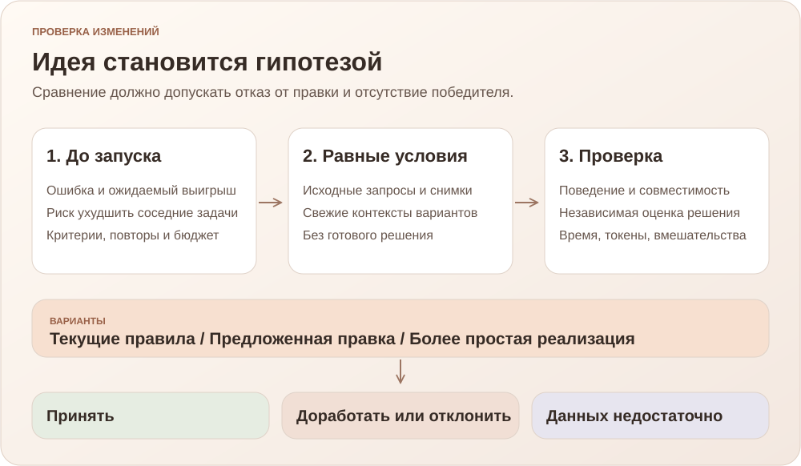

# Как понять, стало ли лучше



На рисунке показан полный перебор для двух записей по одному ключу.
Новый владелец выполняет три шага по порядку. Он получает аренду поколения 2,
готовит новое значение и публикует его. Старый владелец с поколением 1
пытается записать прежнее значение один раз. Вставь эту попытку перед первым
шагом, между первым и вторым, между вторым и третьим или после третьего.

После каждого из четырёх прогонов прочитай ключ. Без проверки поколения
только последняя позиция затирает уже опубликованное значение. Если запись
атомарно сверяет поколение с текущей арендой, прежний владелец может записать
только в первой позиции. Новый владелец затем заменит его значение.
Для контроля дай обеим записям
одинаковое содержимое и отключи проверку поколения. В этой модели у записи
нет других эффектов, поэтому все четыре порядка дают ожидаемое содержимое.

## До изменения

Запиши наблюдаемый отказ, гипотезу, критерий выигрыша и возможную регрессию.
Сравни с текущим поведением и самым простым решением. Добавь вариант без fstack,
если проверяешь пользу пакета. Модельные прогоны требуют отдельного поручения
с вариантами, повторами и бюджетом.

## Корпус задач

Возьми реальный сбой, близкий случай и контрпример. Восстанови исходный запрос,
права и доступные тогда данные. Сохрани эталон, поздние подсказки и приватные
материалы вне копии исполнителя. Выдели закрытые для настройки случаи
(`holdout`). Как только результат такого случая повлиял на правку, переведи
его в корпус разработки. [Примеры запросов](examples.md).

## Сравнение

Дай вариантам одинаковые входы, инструменты, модель и глубину рассуждения,
кроме параметра эксперимента. Начинай со свежих чатов и рабочих копий,
чередуй порядок запусков. Сохрани число задач, повторов и ошибок среды.
Если менялось несколько правил, для вывода о конкретном правиле сравни
дополнительный вариант без него.

## Оценка

1. Проверь результат исполняемым тестом, в том числе сохранность данных и совместимость.
2. Дай независимому оценщику исходную цель, артефакты, анонимные пары и одинаковые
   критерии. Спорные оценки сверь с человеком.
3. Сравни время, расход, вмешательства пользователя и повторную работу.
   Для делегирования сверь реальные вызовы и метаданные исполнителей.

## Решение и срок действия

Прими изменение при воспроизводимом выигрыше без существенных регрессий.
Смешанный результат требует доработки, вред — отклонения, нехватка данных
оставляет вывод открытым. Сохрани SHA, среду, артефакты и основание решения.
После смены клиента, модели или инструкций перепроверь затронутые выводы.

## Проверка цикла ревью

Передай рецензенту требования и исходные base/head. Используй известную
регрессию и чистый контроль. Эталон видит только оценщик.

После исправления проверь новый head, сохранение ID замечания, устаревший отчёт
и передачу владельцу после третьего раунда. Считай пропуски, ложные замечания и
раунды. [Цикл ревью](../skills/review/references/cycle.md).

## Исполняемый эксперимент

Для проверки сценариев нужен Python 3.12+. Для модельного эксперимента также
нужен Codex CLI с App Server и профилями разрешений. Храни банк своего
эксперимента и результаты вне репозитория. В WSL используй файловую систему
Linux с POSIX-правами. Первый критерий описывает наблюдаемое поведение.
`before_failure` фиксирует строку ожидаемого отказа. Чистый контроль должен
проходить на исходной и эталонной версии.

### Сценарии маршрутизации

[Проверка маршрута](../tools/fstack/evals/check_routing.py) использует установленный
пакет и наблюдаемые действия. `quoted` проверяет, что пояснение цитаты не запускает
команды и агентов. `local-review` требует открыть инструкцию `watch-pr` до чтения
вымышленного снимка MR. `delegate` сверяет чтение навыка, число исполнителей,
подтверждённую глубину и ответ. Сценарии локальные, рабочие файлы после хода
сверяются с исходными.

Для отдельного порученного прогона укажи установленный снимок с бинарником
и явно выбери случаи.

```bash
python tools/fstack/evals/check_routing.py /absolute/path/to/package --codex /absolute/path/to/codex --auth-home /absolute/path/auth-profile --model MODEL --effort high --case quoted --case local-review --case delegate --output /absolute/path/routing-report
```

Сохраняются первичные наблюдения и нарушения по каждому случаю. В CI тестируются
правила оценки на контрольных трассах. Прогон с моделью выполняется отдельно.

### Сценарии Python/AQA без моделей

[Открытый банк](../tools/fstack/evals/fixtures/python_aqa/bank.json) содержит
вымышленные задачи и чистые контроли. В пакетной операции проверяются отмена
и очистка соседней задачи, а для независимых отправок проверяется порядок
отдельных успехов и ошибок. Остальные сценарии проверяют обязательное
предусловие, независимый ожидаемый итог, состояние следующего теста после
частичного сбоя подготовки и подставляемое время. Первоначальный код должен
падать по заявленной причине для шести задач и проходить четыре контроля.
Исправленная версия должна проходить все десять проверок.

Локально из корня репозитория запусти проверки runner и сценариев. В них
входят четыре запуска [примера с журналом](examples.md#повторить-аудит-блокировки)
через pytest. Локальная выборка даёт два успешных теста в обоих режимах.
Маркер `quick` даёт три успеха при обычной очистке и два успеха с одним
`FileExistsError` при `--keep-lock`.

```bash
python -m pip install -r tools/fstack/evals/requirements.txt
python -m unittest discover -s tools/fstack/evals -v
python tools/fstack/evals/evaluate.py --bank tools/fstack/evals/fixtures/python_aqa/bank.json validate-corpus --output /absolute/path/python-aqa-check
```

`validate-corpus` берёт данные из Git и запускает исполняемый код выбранного
репозитория. Используй доверенный источник и новый каталог вывода. В `base`
и `reference` открытый банк хранит полные SHA деревьев Git с исходной и
исправленной копиями. Эти деревья входят в обычный checkout после squash
или rebase.
Допустимые проверяющие модули, классы и команда `unittest` определены в
[runner](../tools/fstack/evals/corpus.py). В банк входят имя проверки и
ожидаемый отказ. При сбое запуска, подготовки, пропуске или отсутствии
собранного теста результат имеет статус `unavailable`.

### Модельный эксперимент

```bash
python tools/fstack/evals/evaluate.py --bank /absolute/path/bank.json validate-corpus --output /absolute/path/corpus-check
python tools/fstack/evals/evaluate.py doctor --codex /absolute/path/codex --auth-home /absolute/path/auth-profile --output /absolute/path/doctor.json
```

`doctor` проверяет изоляцию до обращения к модели, `--probe-model MODEL`
добавляет один модельный вызов.

Создай план в пустом каталоге. Он фиксирует SHA, корпус, гипотезу, модель,
глубину, повторы, seed и тайм-аут. `--alternative REF` добавляет вариант,
`--alternative none` — запуск без fstack. Фильтр `--case ID` можно повторять.

```bash
python tools/fstack/evals/evaluate.py --bank /absolute/path/bank.json plan --output /absolute/path/experiment/plan.json --hypothesis "Сохраняется весь полезный результат" --baseline origin/main --candidate HEAD --alternative none --model MODEL --effort medium --repetitions 3
python tools/fstack/evals/evaluate.py --bank /absolute/path/bank.json calibrate --case CASE_ID --plan /absolute/path/experiment/plan.json --codex /absolute/path/codex --auth-home /absolute/path/auth-profile --model JUDGE_MODEL --effort high --max-attempts 3
python tools/fstack/evals/evaluate.py --bank /absolute/path/bank.json run --plan /absolute/path/experiment/plan.json --codex /absolute/path/codex --auth-home /absolute/path/auth-profile --max-attempts 4
python tools/fstack/evals/evaluate.py --bank /absolute/path/bank.json judge --plan /absolute/path/experiment/plan.json --codex /absolute/path/codex --auth-home /absolute/path/auth-profile --model JUDGE_MODEL --effort high --max-attempts 4
python tools/fstack/evals/evaluate.py --bank /absolute/path/bank.json report --plan /absolute/path/experiment/plan.json
```

Выполняй команды одного эксперимента последовательно. На калибровку отведи
сразу три попытки. После неполной или неудачной калибровки разберись с причиной
и создай новый план. `run` продолжает неначатые попытки, для повтора ошибок нужен
новый эксперимент. `--max-attempts` ограничивает число новых попыток за вызов.
Денежный бюджет и время учитывай отдельно.

Каждая попытка получает отдельные чат, профиль и копию без Git-истории.
Авторизация временная. До запуска runner проверяет изоляцию чтения и записи,
включая Windows. Решатель работает без сети и видит файлы закреплённого
пакета. [Установку и хуки проверяют клиентом](development.md#проверка-фактическим-клиентом).

Перед модельным запуском runner проверяет исходный отказ и эталон в отдельных
копиях. Решатель получает только отобранные исходники сценария. После остановки
решателя runner добавляет закреплённую проверку в копию результата.
Проверка исполнения импортирует код кандидата, поэтому отдельно оцени diff.
Судья получает перемешанные A/B и критерии без исхода теста. Калибровка
включает дефект, исправление, обратный порядок и ничью.

В `REPORT.md` и `report.json` сверяй хеши, diff, оценки и калибровку.
Отсутствующий расход остаётся неизвестным. В событиях `subAgentActivity`
новый агент отмечен `kind: started`. `configured` передаёт параметры клиента,
`model/rerouted` — наблюдаемую смену модели.

Для `accept` runner требует три повтора, holdout и контроль, завершённые
проверки, калибровку и повторяемый выигрыш на двух случаях, включая holdout,
без проигрышей и нарушений контракта. Остальные исходы — `revise`, `reject`
и `inconclusive`. При нескольких вариантах сравниваются все пары.
CI проверяет runner и сценарии без моделей. Доставка инструкций в Codex
проверяется отдельно на локальной заглушке. Выбор и действия модели требуют
отдельного эксперимента. Открытые сценарии подходят для разработки и контроля.
