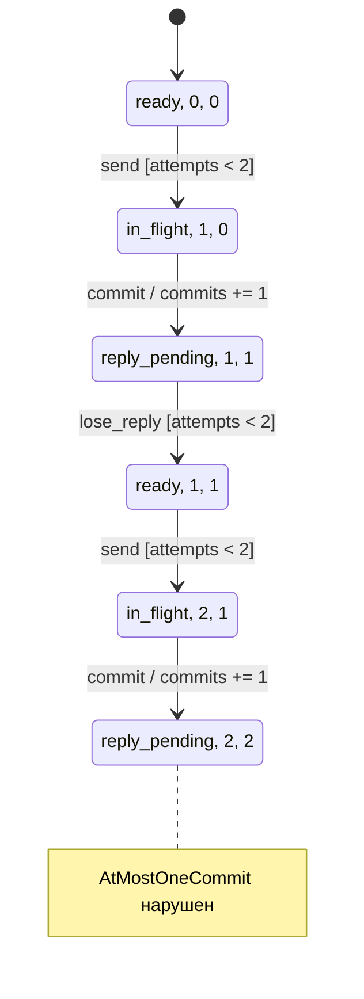

# Проверка конечной модели и replay на Python и Rust

Используй настроенный checker проекта, если он подходит для свойства.
В примере ниже отдельный Rust-чекер обходит конечную модель в ширину.
Для liveness нужен checker, который проверяет временное свойство с
допущениями о fairness. Сохрани префикс трассы и замкни цикл в Mermaid
стрелкой к состоянию, указанному checker. Если трасса завершается
stuttering, покажи самопетлю без изменения состояния.

## Модель повтора запроса

Контракт требует не более одной записи для одного request ID. Модель
[check.rs](retry/check.rs) различает отправку, применение записи и
доставку или потерю ответа. Один клиент отправляет запрос с одним ID,
не более двух последовательных попыток. Вторая возможна после потери
первого ответа. Параллельные запросы, сбои хранилища и истечение срока
хранения ключа исключены. Свойство safety `AtMostOneCommit` требует
`commits <= 1` в каждом достижимом состоянии. В обоих вариантах
пределы и переходы одинаковы. Дедупликация меняет только эффект `commit`.

[Python replay](retry/replay.py) и [Rust replay](retry/replay.rs) читают
файл событий от checker. Модель хранит счётчик, а реализации примера
добавляют один и тот же ID в журнал и считают фактически записанные строки.
Дедупликация в этих последовательных реализациях проверяет наличие ID
перед добавлением. Для реальной системы отдельно установи, какой механизм
делает эти действия атомарными и переживает ли он сбои.

| Переход модели | Replay на Python и Rust |
| --- | --- |
| Начальное состояние | Пустой журнал, попыток ещё нет |
| `send` | Открывает очередную попытку для `order-17` |
| `commit` | Добавляет `order-17` или сохраняет уже записанную строку при дедупликации |
| `lose_reply` после первой попытки | Возвращает сценарий к отправке, запись остаётся в журнале |
| `deliver_reply` или потеря второго ответа | Ветки модели после ожидающего ответа. Найденная трасса заканчивается раньше, на втором `commit` |

## Повторить проверку

Скопируй `check.rs`, `replay.py` и `replay.rs` из установленного навыка
в отдельный рабочий каталог. Проверено с Rust 1.90.0 и Python 3.14.7.
Команды используют стандартные библиотеки. Запускай команды по отдельности
из рабочего каталога и сохраняй коды возврата, вывод и файлы трасс.

```text
rustc --edition 2021 check.rs -o check.exe
rustc --edition 2021 replay.rs -o replay.exe
./check.exe broken broken.trace
./check.exe fixed fixed.trace
python replay.py broken broken.trace
python replay.py fixed broken.trace
./replay.exe broken broken.trace
./replay.exe fixed broken.trace
```

Чекер пишет файл трассы в UTF-8 сам. Для `broken` ожидаются код 1,
диагностика `AtMostOneCommit violated` и пять событий. Обход в ширину
ставит в очередь состояния в порядке неубывания расстояния от начала,
поэтому первый найденный контрпример кратчайший по числу переходов в
этой модели. Для `fixed` ожидаются код 0, пустая трасса и
`AtMostOneCommit holds: states=9 queue=0`. Ошибка аргументов или записи
трассы возвращает код 2. В обоих replay ожидается код 0 при проверке
своего варианта. Последний `commit` даёт две записи в `broken` и одну
в `fixed`. Обход подтверждает свойство в границах модели, а replay
проверяет один порядок событий на двух реализациях примера.

## Контрпример в Mermaid

Узлы проецируют `(phase, attempts, commits)` по событиям из `broken.trace`
и счётчикам replay. Подписи указывают события, условия и эффект записи.
В `broken` переход `commit` из `in_flight` всегда увеличивает счётчик.
При необходимости сохрани исходник `.mmd` и SVG рядом с трассой и логом.
Синтаксис описан в [Mermaid State diagrams](https://mermaid.js.org/syntax/stateDiagram.html).


